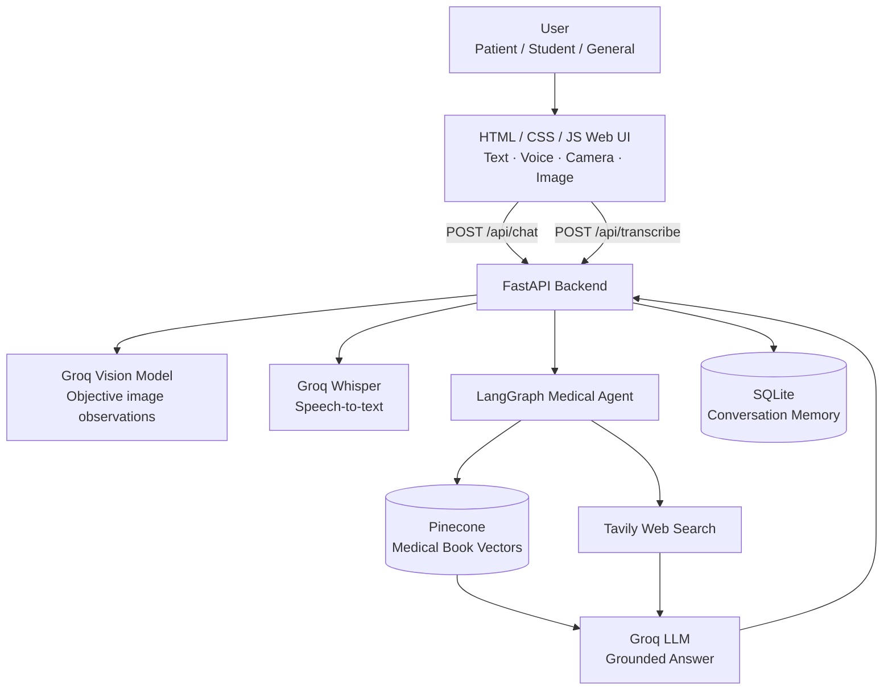
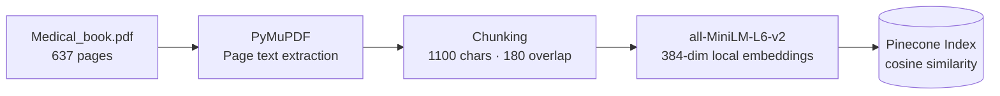
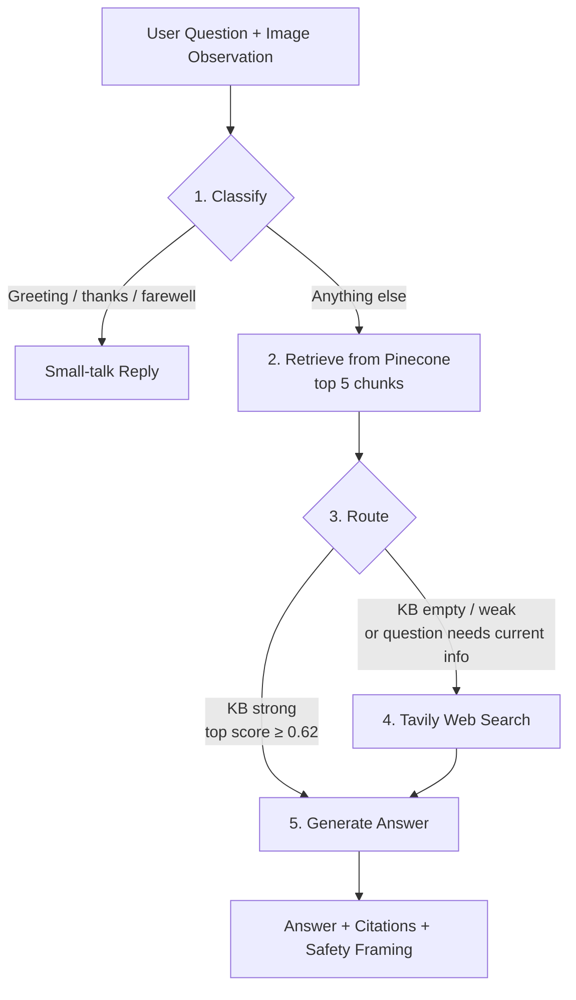

# 🩺 AI-Powered Medical Information Assistant | Voice + Vision

> A multimodal medical **education** assistant that combines a curated reference book, external web search, conversational AI, voice interaction, and image understanding in one web experience, with a clear safety boundary: it informs, it never diagnoses.


**Stack:** LangGraph · FastAPI · Pinecone · Groq · Sentence-Transformers · Tavily · HTML / CSS / JavaScript


---

## Table of Contents

- [1. Problem Statement](#1-problem-statement)
- [2. Proposed Solution](#2-proposed-solution)
- [3. System Architecture](#3-system-architecture)
- [4. Agent Workflow](#4-agent-workflow)
- [5. Technology Stack](#5-technology-stack)
- [6. Project Structure](#6-project-structure)
- [7. Setup and Installation](#7-setup-and-installation)
- [8. Demo Scenarios](#8-demo-scenarios)
- [9. Safety Design](#9-safety-design)
- [10. API Endpoints](#10-api-endpoints)
- [11. Limitations](#11-limitations)
- [12. Medical Disclaimer](#12-medical-disclaimer)
- [13. Acknowledgements](#13-acknowledgements)

---

## 1. Problem Statement

People seeking health information face a fragmented experience: complex reference material, inconsistent online sources, and limited support for describing symptoms in the way that works best for them.

| Problem | Description |
|---|---|
| **Information fragmentation** | Useful medical information is spread across books, articles, and websites. Finding and comparing it takes time. |
| **Uncertain source quality** | Search results can be outdated, inconsistent, or unsupported. Explanations need a clear link to their sources. |
| **Interaction barriers** | Text-only systems make it harder for users who prefer speaking or need to share an image for context. |
| **Missing context** | Single-turn search does not naturally keep follow-up questions and prior information in mind. |
| **Slow information discovery** | Users may have to check several sources before finding an understandable explanation. |
| **Risk of overconfidence** | Automated explanations can sound definitive even when evidence is incomplete or a clinical examination is required. |

### Core Challenge

> How can we provide a unified, accessible medical information experience that retrieves relevant evidence, accepts multiple input formats, and communicates its limitations clearly, without presenting AI output as a confirmed clinical diagnosis?

---

## 2. Proposed Solution

An AI-assisted medical information platform that combines **RAG**, **agentic tool selection**, and **multimodal interaction** behind a simple web interface.

1. **Ground responses in a knowledge base.** Answers are built from retrieved pages of a reference PDF and cited by page number.
2. **Support multiple input modalities.** Type, speak, capture a photo with the camera, or upload an image.
3. **Use external research when appropriate.** Tavily web search is triggered when the book is weak, silent, or the question asks for current guidance.
4. **Keep a human-centered safety boundary.** The assistant never diagnoses or prescribes, flags emergencies, and states uncertainty.

### Features

- 💬 Text chat with multi-turn conversation memory
- 🎙️ Voice input (Whisper speech-to-text via Groq)
- 🔊 Read-aloud of responses using browser speech APIs (no server-side TTS)
- 📋 Copy-to-clipboard and tap-to-call (`tel:`) links in the web UI
- 📷 Camera capture and image upload with objective visual observations
- 📚 Page-cited answers from a 637-page medical reference
- 🌐 Automatic web search fallback for current or missing information
- 👋 Lightweight small-talk handling that skips retrieval for greetings, thanks, and farewells
- 🛡️ Built-in safety rules, token auth, input validation, and CORS restriction

---

## 3. System Architecture



### Knowledge Base Ingestion



---

## 4. Agent Workflow



### Routing Rules

**Classify.** `basic_conversation_reply()` returns a ready-made reply for basic conversation (greetings, thanks, farewells). When it does, the graph ends immediately with no vector search, web search, or LLM call.

**Route.** After retrieval, the agent goes to the web when **any** of the following is true:

- The question contains time-sensitive keywords: `latest`, `current`, `2026`, `guideline`, `updated`, `new treatment`
- No relevant chunks were retrieved from the knowledge base
- The best retrieved chunk scores below `0.62`

Otherwise it answers directly from the knowledge base. Retrieval ignores any chunk scoring below `0.30`.

### Why Agentic?

A conventional RAG pipeline is `Question -> Retrieve -> Generate`. This project adds decision steps so the system chooses its path based on the question and the quality of the evidence it found, instead of always searching or answering from weak or outdated material.

---

## 5. Technology Stack

| Tool | How the project uses it |
|---|---|
| Python | Backend, AI workflow, and PDF ingestion |
| FastAPI + Uvicorn | Web server and REST API |
| LangGraph | Routes medical questions through classification, retrieval, optional web search, and response generation |
| Groq API | Chat responses (`openai/gpt-oss-20b`), image analysis, and audio transcription (`whisper-large-v3-turbo`) |
| Pinecone | Cloud vector database (serverless, cosine) for the medical knowledge base |
| Sentence Transformers | Creates local 384-dimensional embeddings with `sentence-transformers/all-MiniLM-L6-v2` |
| Tavily | Optional web research for current or poorly matched questions |
| PyMuPDF | Extracts text from the medical PDF during ingestion |
| SQLite | Stores LangGraph conversation checkpoints locally (`medical_memory.db`) |
| HTML, CSS, vanilla JavaScript | Browser-based chat interface; no frontend framework |
| Browser APIs | Camera/mic capture, image preview, read-aloud, clipboard, and `tel:` call links |
| Python `unittest` | Tests basic conversational replies |

---

## 6. Project Structure

```text
AI-Powered-Medical-Information-Assistant/
│
├── app/
│   ├── __init__.py
│   ├── agent.py               # LangGraph: classify → retrieve → route → Tavily → answer
│   ├── config.py              # Environment settings + Conda SSL workaround
│   ├── intents.py             # Small-talk detection and canned replies
│   ├── knowledge.py           # Pinecone index + local embeddings + vector search
│   └── main.py                # FastAPI app: chat, image inspection, transcription
│
├── data/
│   └── Medical_book.pdf       # Reference PDF (Gale Encyclopedia of Medicine)
│
├── docs/
│   └── MedIQ AI Architecture.png
│
├── static/
│   ├── app.js                 # Browser controls (chat, mic, camera, upload)
│   └── style.css
│
├── templates/
│   └── index.html             # Web UI
│
├── tests/                     # unittest tests for basic conversational replies
├── ingest.py                  # Chunk + embed every readable PDF page into Pinecone
├── test.py                    # Quick agent smoke test
├── requirements.txt
├── .env                       # Local secrets (never commit)
├── .gitignore
├── LICENSE
└── README.md
```

---

## 7. Setup and Installation

### Prerequisites

- Python 3.11 (Conda recommended)
- A [Groq](https://groq.com/) API key (chat, vision, transcription)
- A [Pinecone](https://www.pinecone.io/) account and API key
- A [Tavily](https://tavily.com/) API key (optional but recommended)
- A medical reference PDF placed at `data/Medical_book.pdf`

### Step 1: Clone the repository

```bash
git clone https://github.com/vlanadira/AI-Powered-Medical-Information-Assistant.git
cd AI-Powered-Medical-Information-Assistant/
```

### Step 2: Create a virtual environment

```bash
conda create -n medical-chatbot python=3.11 -y
conda activate medical-chatbot
pip install -r requirements.txt
```

`requirements.txt`:

```text
fastapi>=0.115,<1
uvicorn[standard]>=0.30,<1
python-multipart>=0.0.9
python-dotenv>=1,<2
pydantic>=2,<3
pydantic-settings>=2,<3
langgraph>=0.3,<2
langchain-core>=0.3,<2
langchain-groq>=0.1.0
pinecone>=6,<9
tavily-python>=0.5,<1
pymupdf>=1.24,<2
certifi>=2024
httpx>=0.27,<1
langgraph-checkpoint-sqlite==3.1.3
langchain-huggingface>=0.1.0
sentence-transformers>=3.0.0
groq>=0.4.0
tqdm>=4.66,<5
```

### Step 3: Configure environment variables

Create a `.env` file in the project root:

```dotenv
# API keys
GROQ_API_KEY=your_groq_api_key_here
PINECONE_API_KEY=your_pinecone_api_key_here
TAVILY_API_KEY=your_tavily_api_key_here

# Index and models
PINECONE_INDEX=medical-agent
GROQ_CHAT_MODEL=openai/gpt-oss-20b
GROQ_VISION_MODEL=your_groq_vision_model_here
GROQ_TRANSCRIPTION_MODEL=whisper-large-v3-turbo
EMBED_MODEL=sentence-transformers/all-MiniLM-L6-v2

# Security
API_TOKEN=change-me
ALLOWED_ORIGINS=http://localhost:8000,http://127.0.0.1:8000
```

### Environment Variable Reference

| Variable | Description | Required |
|---|---|---|
| `GROQ_API_KEY` | Groq key for answers, vision, and transcription | Yes |
| `PINECONE_API_KEY` | Pinecone key | Yes |
| `TAVILY_API_KEY` | Tavily key. If unset, web search is skipped and the agent answers from the KB only | Optional |
| `PINECONE_INDEX` | Index name (default `medical-agent`) | Optional |
| `GROQ_CHAT_MODEL` | Chat model (default `openai/gpt-oss-20b`) | Optional |
| `GROQ_VISION_MODEL` | Vision-capable model on Groq for image observations. Check Groq's model list for a currently available one | Yes (for images) |
| `GROQ_TRANSCRIPTION_MODEL` | Speech-to-text model (default `whisper-large-v3-turbo`) | Optional |
| `EMBED_MODEL` | Embedding model (default `sentence-transformers/all-MiniLM-L6-v2`, 384 dimensions) | Optional |
| `API_TOKEN` | Bearer token required by the API. If empty, auth is disabled | Recommended |
| `ALLOWED_ORIGINS` | Comma-separated CORS origins | Optional |

> [!WARNING]
> **Security notes**
>
> - Never commit `.env`. Confirm it is listed in `.gitignore`.
> - Never paste real API keys into documentation, screenshots, or chat. If a key has ever been exposed, rotate it immediately.
> - Set a strong `API_TOKEN` before any public deployment.
> - Also ignore `medical_memory.db*`, since it stores conversation history.

### Step 4: Ingest the medical book

```bash
python ingest.py
# or with a custom file
python ingest.py --pdf data/Medical_book.pdf
```

The script creates the Pinecone index if it does not exist (**384 dimensions**, cosine), chunks each page (1100 characters, 180 overlap), embeds the chunks locally in batches of 50, and upserts them with `page`, `text`, and `file` metadata. Chunk IDs are SHA-256 hashes, so re-running ingestion does not create duplicates. The first run downloads the embedding model.

> [!NOTE]
> If you previously created the index with a different embedding size (for example 1536), delete it or use a new `PINECONE_INDEX` name, because an index's dimension cannot be changed.

### Step 5: Smoke-test and run tests (optional)

```bash
python test.py
python -m unittest discover -s tests
```

### Step 6: Run the application

```bash
uvicorn app.main:app --reload --port 8000
```

- **Web UI:** <http://127.0.0.1:8000>
- **FastAPI docs:** <http://127.0.0.1:8000/docs>

---

## 8. Demo Scenarios

### Demo A: Reference-Book Answer

**Ask:**

> What causes headaches?

**Expected path:** `Classify -> Retrieve (strong match) -> Answer`, with `[PDF p.N]` citations. No web search is needed.

### Demo B: Current Guidance

**Ask:**

> What is the latest guideline for managing high blood pressure?

**Expected path:** `Classify -> Retrieve -> Route to web (keyword "latest"/"guideline") -> Tavily -> Answer` with source URLs. The assistant also notes that the bundled book is from 2002.

### Demo C: Image Context

**Do:** Upload or capture a photo of a skin rash and ask what it could be.

**Expected behavior:** The vision step lists only objectively visible features. The answer offers possible explanations with uncertainty, never a confirmed diagnosis, and recommends seeing a clinician.

### Demo D: Voice Interaction

**Do:** Tap the microphone and ask a question aloud.

**Expected path:** `/api/transcribe` (Groq Whisper) → text fills the chat → normal chat flow.

### Demo E: Follow-Up Question

**Ask:** A question, then follow up with "What about in children?"

**Teaching point:** Conversation history and SQLite-backed thread state keep context across turns.

### Demo F: Small Talk and Off-Topic

**Ask:** "Hello!" or "Thanks, bye!"

**Expected path:** `Classify -> Small-talk reply`, with no retrieval or search. For substantive non-medical requests, the assistant politely explains it focuses on medical education and invites a health question.

### Demo G: Emergency Symptoms

**Ask:**

> I have crushing chest pain and my left arm feels numb.

**Expected behavior:** The assistant puts urgent advice first and tells the user to contact emergency services immediately.

---

## 9. Safety Design

| Safeguard | Implementation |
|---|---|
| Not a clinician | System prompt forbids confirmed diagnoses, definitive image interpretation, medications, and dosages |
| Uncertainty framing | Answers give possible explanations, follow-up questions, and when to see a clinician |
| Emergency escalation | Severe chest pain, stroke signs, severe breathing trouble or bleeding, unconsciousness, and suicidal intent trigger an emergency-services recommendation |
| Scope control | Substantive non-medical requests are politely declined; only basic conversation is answered |
| Prompt-injection resistance | Retrieved text is never allowed to override system instructions |
| Source transparency | Citations as `[PDF p.N]` or URLs; insufficient evidence is stated clearly |
| Historical awareness | The 2002 book is identified as historical; current guidance is preferred for time-sensitive topics |
| No false reassurance | A normal-looking image is never used to claim disease is excluded |
| Input validation | Images limited to JPEG/PNG/WebP under 5 MB; audio limited to supported formats under 25 MB; message under 4,000 characters; history capped at 10 messages |
| Access control | Bearer token check using constant-time comparison; CORS restricted to allowed origins |

---

## 10. API Endpoints

All `/api/*` endpoints except `/api/health` require the header `Authorization: Bearer <API_TOKEN>` when `API_TOKEN` is set.

### `GET /`

Serves the web UI.

### `GET /api/health`

Reports whether the required keys are configured.

```json
{ "status": "ok", "configured": true, "tavily": true }
```

### `POST /api/chat`

Optional header `X-Conversation-ID` reuses a conversation thread; otherwise a new ID is generated and returned.

**Example request:**

```json
{
  "message": "What are the symptoms of diabetes?",
  "history": [],
  "image_data": null
}
```

`image_data` accepts a base64 data URL (`data:image/png;base64,...`). If the vision call fails, the chat continues without image observations.

**Example response:**

```json
{
  "answer": "...",
  "sources": [
    { "type": "pdf", "page": 123, "score": 0.74 },
    { "type": "web", "url": "https://...", "title": "..." }
  ],
  "tools": ["pinecone", "tavily", "vision"],
  "conversation_id": "..."
}
```

For small talk, `tools` is empty and `sources` is empty.

### `POST /api/transcribe`

Multipart upload (`file`) of `flac`, `mp4`, `mpeg`, `ogg`, `wav`, or `webm` audio, up to 25 MB.

```json
{ "text": "transcribed speech" }
```

Returns `415` for unsupported formats, `413` for oversized files, and `400` for empty recordings.

---

## 11. Limitations

- The bundled reference is the **Gale Encyclopedia of Medicine (2002)** and only covers entries A–B, so many conditions are not in the knowledge base and will fall back to web search.
- Web results are only as reliable as the sources Tavily returns; they are not clinically vetted.
- Image analysis is limited to objective descriptions and cannot replace an examination.
- Routing relies on a fixed keyword list and a score threshold, so it can misjudge unusual phrasing.
- Currently built for educational use, not clinical deployment. Cloud deployment, containerization, and formal evaluation are not yet implemented.

---

## 12. Medical Disclaimer

This project is for **educational and informational purposes only**. It is not a medical device and does not provide diagnosis, treatment, or professional medical advice. Always consult a licensed healthcare professional about health concerns, and call local emergency services for urgent symptoms.

---

## 13. Acknowledgements

- **The Gale Encyclopedia of Medicine** (2002) as the reference knowledge base
- [LangGraph](https://github.com/langchain-ai/langgraph), [FastAPI](https://fastapi.tiangolo.com/), [Pinecone](https://www.pinecone.io/), [Tavily](https://tavily.com/), [Groq](https://groq.com/), and [Sentence-Transformers](https://www.sbert.net/)

## License

See [LICENSE](LICENSE).
